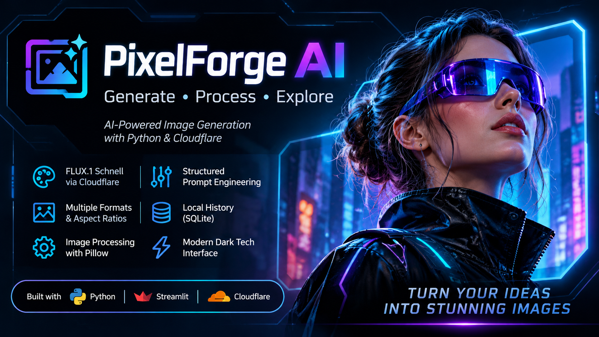

# PixelForge AI
<div align="center">



</div>

An AI-powered image generation application built with Python, Streamlit, and Cloudflare Workers AI.

PixelForge AI is a Python-based application designed to generate, process, manage, and export AI-generated images through an interactive web interface.

Powered by the FLUX.1 Schnell image generation model, running through the Cloudflare Workers AI API, the application combines structured prompt engineering, configurable image generation, local image processing, and persistent generation history in a modular architecture.

The project demonstrates the practical integration of generative AI APIs, Python development, image processing, database persistence, and web application development.

---

## ✨ Features

- 🎨 **AI Image Generation:** Generate images using the FLUX.1 Schnell model through Cloudflare Workers AI.
- 🧠 **Structured Prompt Engineering:** Build detailed image prompts using six dedicated fields: Subject, Composition, Style, Lighting, Colors, and Required Elements.
- 🖥️ **Interactive Web Interface:** Modern Dark Tech interface developed with Streamlit.
- 📐 **Image Aspect Ratios:** Configure square (1:1), landscape (16:9), and portrait (9:16) output formats.
- 🎛️ **Generation Parameters:** Customize inference steps and image output settings.
- 🖼️ **Image Processing:** Process, resize, crop, and export generated images using Pillow.
- 💾 **Persistent Generation History:** Store generation records and metadata locally using SQLite.
- 📥 **Image Export:** Download generated images in PNG, JPEG, and WebP formats.
- 🔍 **Image Metadata:** Retrieve image dimensions, format, color mode, and file size.
- 🔐 **Environment-Based Configuration:** Secure API credential management using environment variables.
- 🧪 **Automated Testing:** Unit and integration tests covering prompt engineering, image processing, database operations, and generation workflows.

## 🛠️ Technology Stack

| Technology | Purpose |
|---|---|
| Python 3 | Core application development |
| Streamlit | Interactive web interface |
| Cloudflare Workers AI | Remote AI inference |
| FLUX.1 Schnell | Image generation model |
| Pillow (PIL) | Image processing and export |
| SQLite | Local generation history |
| Pydantic | Configuration validation |
| python-dotenv | Environment variable management |
| Bash | Command-line operations and automation |
| pytest | Automated testing |

## 🏗️ Architecture

PixelForge AI follows a modular architecture that separates the user interface, image generation, prompt engineering, image processing, configuration, and data persistence.

- **Presentation Layer:** Streamlit interface and user interaction.
- **Prompt Engineering Layer:** Structured prompt construction and validation.
- **Generation Layer:** Communication with Cloudflare Workers AI and image inference.
- **Image Processing Layer:** Image validation, cropping, resizing, format conversion, and file storage.
- **Persistence Layer:** SQLite database for generation records and metadata.
- **Configuration Layer:** Model settings, API credentials, and generation parameters.

This separation of responsibilities promotes maintainability, modularity, and future extensibility.

## 📁 Project Structure

```text
pixelforge-ai/
│
├── app.py
├── requirements.txt
├── test_core.py
├── .env.example
├── .gitignore
├── README.md
├── LICENSE
├── run.sh
│
├── assets/
│   ├── pixelforge-banner.png
│   ├── pixelforge-icon.png
│   └── sidebar-banner.png
│
├── config/
│   ├── __init__.py
│   └── settings.py
│
├── core/
│   ├── __init__.py
│   ├── generator.py
│   ├── generation_service.py
│   ├── image_processor.py
│   ├── prompt_engine.py
│   └── database.py
│
├── tests/
│   ├── test_api.py
│   ├── test_generation_service.py
│   ├── test_image_processor.py
│   └── test_prompt_engine.py
│
└── data/  # Created locally, excluded from Git
    ├── pixelforge.db
    └── images/
```

Directory responsibilities:

- `app.py` — Main Streamlit application and user interface.
- `config/` — Application settings and environment configuration.
- `core/generator.py` — Cloudflare Workers AI communication.
- `core/generation_service.py` — Image generation workflow orchestration.
- `core/image_processor.py` — Image validation, processing, and export.
- `core/prompt_engine.py` — Structured prompt construction and validation.
- `core/database.py` — SQLite database operations and generation history.
- `tests/` — Automated tests for core application functionality.
- `data/` — Local database and generated image storage.

The `data/` directory and its contents are generated locally and excluded from version control.

## ⚙️ Requirements

- Python 3.10 or newer.
- pip.
- Internet connection.
- Cloudflare account with Workers AI access.
- Cloudflare Account ID.
- Cloudflare API Token with the required Workers AI permissions.

The image generation model runs remotely through Cloudflare Workers AI. Local GPU hardware is not required for image generation.

## 🚀 Installation

### 1. Clone the repository

```bash
git clone https://github.com/rafahalav/pixelforge-ai.git
cd pixelforge-ai
```

### 2. Create a virtual environment

```bash
python3 -m venv venv
```

### 3. Activate the environment

Linux / macOS:

```bash
source venv/bin/activate
```

Windows:

```bash
venv\Scripts\activate
```

### 4. Install dependencies

```bash
pip install -r requirements.txt
```

### 5. Configure Cloudflare credentials

Create a `.env` file in the project root directory, using `.env.example` as a reference.

```env
CLOUDFLARE_ACCOUNT_ID=your_cloudflare_account_id
CLOUDFLARE_API_TOKEN=your_cloudflare_api_token

CLOUDFLARE_IMAGE_MODEL=@cf/black-forest-labs/flux-1-schnell
```

Replace the placeholder values with your own Cloudflare credentials.

Important: Never commit your `.env` file or expose API credentials in source code.

### 6. Run the application

With the virtual environment activated:

```bash
streamlit run app.py
```
Or
```bash
./run.sh
```

Streamlit will start the application and provide a local URL to access the PixelForge AI interface through your browser.

## 🎛️ Generation Configuration

PixelForge AI provides configurable image generation options through its interface.

**Prompt Fields**

- Subject — Defines the main subject of the image.
- Composition — Controls framing, perspective, and spatial arrangement.
- Style — Defines the artistic direction and visual language.
- Lighting — Specifies lighting conditions and atmosphere.
- Colors — Defines the desired color palette.
- Required Elements — Specifies mandatory visual elements.

**Generation Parameters**

| Parameter | Options |
|---|---|
| Image Model | FLUX.1 Schnell |
| Inference Steps | 1–8 |
| Aspect Ratio | Square, Landscape, Portrait |
| Output Format | PNG, JPEG, WebP |
| Compression Quality | 70–100 for JPEG and WebP |

The current model integration generates square source images at 1024 × 1024 pixels. Landscape and portrait outputs are produced through local cropping and resizing.

PNG output uses lossless compression. JPEG and WebP provide configurable compression quality.

## 💾 Data Persistence

PixelForge AI uses SQLite to maintain a local record of image generation activities.

The database stores:

- Unique image identifiers.
- Generation prompts.
- Model information.
- Inference steps.
- Output dimensions.
- Image format and quality metadata.
- Image file paths.
- Generation timestamps.

Generated images are stored locally in the `data/images/` directory.

The application also provides generation history management, allowing users to retrieve previous results and manage stored images.

## 🔐 Security

Cloudflare credentials are managed through environment variables using `python-dotenv`.

The project excludes sensitive and local development files from version control, including:

- `.env` files.
- Python virtual environments.
- Python cache files.
- Local SQLite databases.
- Generated image files.
- Temporary development artifacts.

Users must provide their own Cloudflare credentials to access the image generation API.

Generation history and image files are stored locally on the user's machine.

## 🧪 Automated Testing

The project includes automated tests using pytest to verify core application functionality.

| Test Module | Purpose |
|---|---|
| `test_prompt_engine.py` | Prompt construction and validation |
| `test_image_processor.py` | Image validation, dimensions, formats, and processing |
| `test_generation_service.py` | Generation workflow and service integration |
| `test_api.py` | Cloudflare configuration validation |

Run the automated test suite:

```bash
pytest -v
```

The core image processing and prompt engineering tests can be executed locally without consuming Cloudflare image generation resources.

The Cloudflare configuration test requires valid credentials in the `.env` file but does not make API requests or consume image generation resources.

## 📌 Project Status

**Version 1.0.0 — Initial Development Release**

PixelForge AI is an evolving personal software project.

The current release focuses on reliable AI image generation, structured prompt engineering, local image processing, generation history, and a practical user experience.

Future development may include AI-powered image upscaling, enhanced image quality controls, and additional image processing capabilities.

## 📄 License

This project is licensed under the MIT License.
See the [LICENSE](LICENSE) file for details.

## 🧑‍💻 Author

**Rafael Halav**

- GitHub: [@rafahalav](https://github.com/rafahalav)

---

Built with Python, artificial intelligence, and a passion for technology.
# pixelforge-ai
